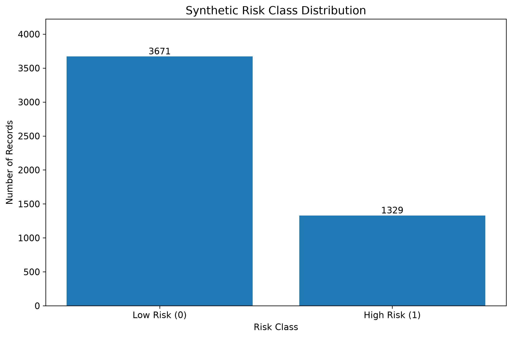
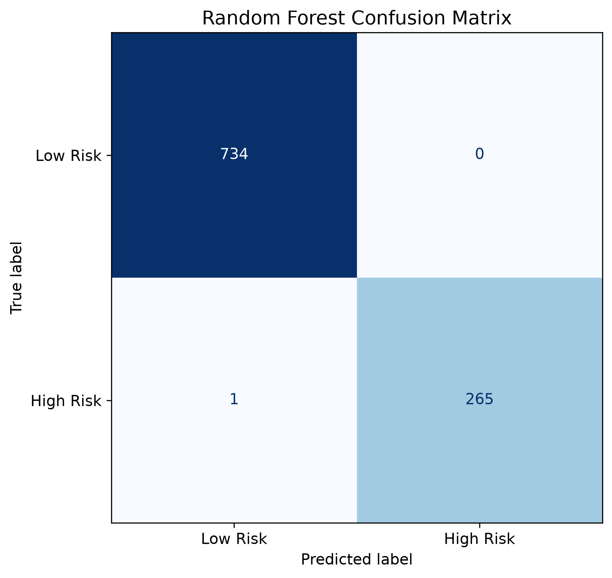
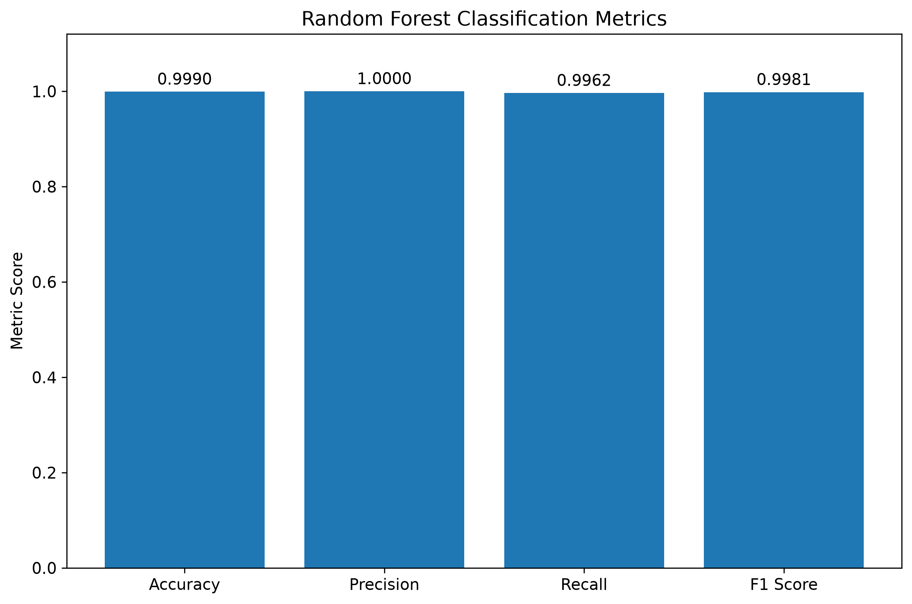
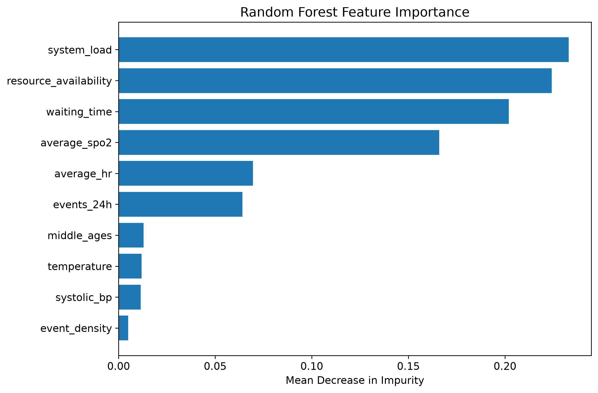
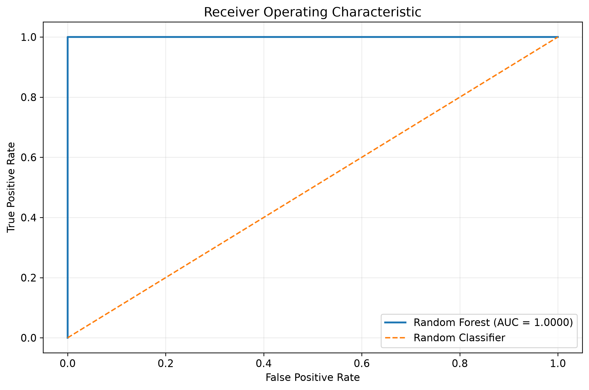
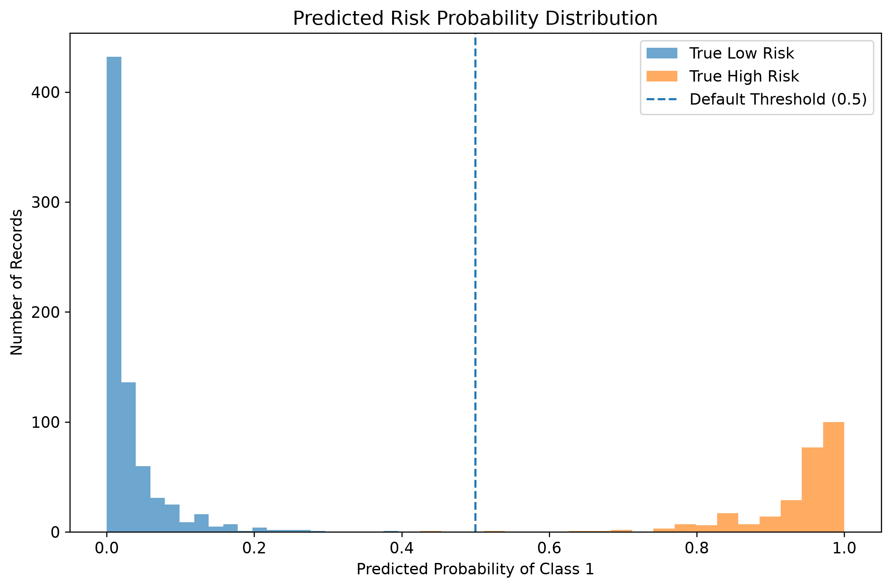
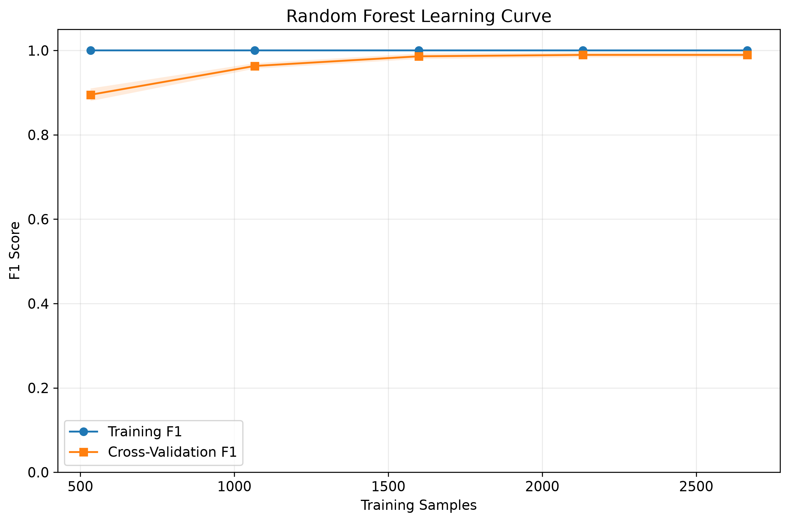

# FIAP - Faculdade de Informática e Administração Paulista

<p align="center">
  <a href="https://www.fiap.com.br/">
    
  </a>
</p>

<br>

# CardioIA — Multi-Agent Cardiac Risk Prediction System

## Grupo São Paulo e Interior

## Integrantes

- <a href="https://www.linkedin.com/in/jonastadeufernandes">Jonas Tadeu V. Fernandes - RM563027</a>
- <a href="https://www.linkedin.com/">Levi Passos Silveira Marques - RM56557</a>
- <a href="https://www.linkedin.com/in/raphaelsilva-phael">Raphael da Silva - RM561452</a>
- <a href="https://www.linkedin.com/in/raphael-dinelli-8a01b278">Raphael Dinelli Neto - RM562892</a>
- <a href="https://www.linkedin.com/in/yan-cotta">Yan Pimental Cotta - RM562836</a>

## Professores

### Tutor

- <a href="https://www.linkedin.com/in/caique-nonato/">Caique Nonato da Silva Bezerra</a>

### Coordenador

- <a href="https://www.linkedin.com/in/andregodoichiovato">André Godoi</a>

---

## 📜 Descrição

O **CardioIA — Multi-Agent Cardiac Risk Prediction System** é um projeto acadêmico desenvolvido no curso de Tecnologia em Inteligência Artificial da FIAP. Seu objetivo é estudar a aplicação de aprendizado de máquina supervisionado e sistemas multiagentes na identificação de situações sintéticas de risco em ambientes hospitalares.

A solução utiliza uma base de dados sintética com 5.000 registros, contendo variáveis relacionadas a indicadores fisiológicos e condições operacionais de um sistema hospitalar, como frequência cardíaca, saturação de oxigênio, pressão arterial sistólica, tempo de espera, carga do sistema e disponibilidade de recursos.

Na primeira etapa, foi desenvolvido um modelo de classificação supervisionada utilizando o algoritmo **Random Forest Classifier**, disponibilizado pela biblioteca Scikit-learn. O modelo foi treinado para classificar os registros em duas categorias: ausência de pico de risco (0) ou presença de pico de risco (1).

O desenvolvimento contempla geração dos dados, análise exploratória, separação dos conjuntos de treinamento e teste, treinamento, persistência do modelo e avaliação por métricas de classificação.

Para ampliar a análise, foram desenvolvidas visualizações com Matplotlib, incluindo distribuição das classes, matriz de confusão, importância das variáveis, curva ROC, distribuição das probabilidades e curva de aprendizado.

O modelo treinado é armazenado em um arquivo `.joblib`, permitindo sua reutilização sem a necessidade de executar novamente o treinamento.

Além disso, foram implementados componentes Python para realizar inferências e identificar protocolos operacionais simulados. Esses componentes fornecem uma interface para integração posterior com agentes especializados.

Na segunda etapa do projeto, está prevista a utilização do **OpenAI Agents SDK**, com agentes responsáveis pela análise de risco, consulta a protocolos, planejamento de respostas e orquestração do fluxo, utilizando ferramentas, handoffs, histórico de mensagens e validação de saída.

O objetivo educacional é demonstrar como modelos supervisionados podem fornecer informações estruturadas para sistemas inteligentes compostos por múltiplos agentes.

**Importante:** os registros, os protocolos e os rótulos de classificação são sintéticos. O sistema não possui validação clínica e não deve ser utilizado para diagnóstico, triagem ou tomada de decisões médicas reais.

---

## 🎯 Objetivos

### Objetivo geral

Desenvolver uma solução experimental baseada em Machine Learning e arquitetura multiagente para classificar eventos sintéticos de risco e apoiar a seleção de protocolos operacionais simulados.

### Objetivos específicos

- Gerar uma base de dados sintética e reproduzível.
- Realizar análise exploratória e verificar a qualidade dos dados.
- Implementar um classificador Random Forest.
- Dividir os dados em conjuntos de treinamento e teste.
- Avaliar o modelo com métricas de classificação.
- Analisar graficamente o comportamento do modelo.
- Armazenar o modelo treinado para reutilização.
- Desenvolver uma interface Python para inferência.
- Implementar regras determinísticas para protocolos simulados.
- Preparar a integração com o OpenAI Agents SDK.

---

## 🛠 Tecnologias utilizadas

| Tecnologia | Aplicação |
|---|---|
| Python 3.12 | Linguagem principal de desenvolvimento |
| NumPy | Operações numéricas e geração dos dados |
| Pandas | Manipulação e análise de dados |
| Scikit-learn | Treinamento e avaliação do Random Forest |
| Joblib | Persistência do modelo treinado |
| Matplotlib | Visualização dos resultados |
| Seaborn | Biblioteca complementar de visualização |
| Visual Studio Code | Ambiente de desenvolvimento |
| Git e GitHub | Versionamento e colaboração |
| OpenAI Agents SDK | Integração multiagente prevista na Parte 2 |

As versões exatas das bibliotecas devem ser consultadas no ambiente de execução e registradas para reprodutibilidade.

---

## 📁 Estrutura de pastas

Dentre os arquivos e pastas presentes na raiz do projeto, definem-se:

- **.github**: arquivos de configuração específicos do GitHub para gerenciamento e automação.
- **assets**: elementos não estruturados utilizados no repositório, incluindo imagens e a identidade visual.
- **config**: arquivos de configuração e parâmetros do projeto, quando necessários.
- **document**: documentos solicitados pela atividade e materiais complementares.
- **scripts**: scripts auxiliares de automação, execução e manutenção, quando necessários.
- **src**: código-fonte do projeto, incluindo geração dos dados, treinamento, agentes e testes.
- **docs**: documentação técnica e gráficos de desempenho.
- **requirements.txt**: dependências Python da aplicação.
- **README.md**: documentação geral do projeto.

### Estrutura dos módulos implementados

```text
2TIAOA-CAP01-F6/
|
|-- assets/
|   |-- logo-fiap.png
|
|-- docs/
|   |-- images/
|       |-- 01_class_distribution.png
|       |-- 02_confusion_matrix.png
|       |-- 03_model_metrics.png
|       |-- 04_feature_importance.png
|       |-- 05_roc_curve.png
|       |-- 06_probability_distribution.png
|       |-- 07_learning_curve.png
|       |-- model_metrics.json
|
|-- src/
|   |-- analysis/
|   |   |-- model_visualization.py
|   |
|   |-- agents/
|   |   |-- agent_ml.py
|   |   |-- protocol_agent.py
|   |   |-- ml_interface.py
|   |
|   |-- data/
|   |   |-- synthetic_data.csv
|   |   |-- test_data.csv
|   |
|   |-- models/
|   |   |-- risk_model.joblib
|   |
|   |-- tests/
|   |   |-- test_agent_ml.py
|   |   |-- test_protocol_agent.py
|   |   |-- test_ml_interface.py
|   |
|   |-- train-validation-ml/
|       |-- generation_data.py
|       |-- exploratory_analysis.py
|       |-- train_model.py
|       |-- avaliation_model.py
|
|-- requirements.txt
|-- README.md
```

A organização poderá ser ampliada com os módulos da Parte 2.

---

## 🧠 Parte 1 — Modelo de Machine Learning

### 1. Geração dos dados sintéticos

Foi utilizada uma base de 5.000 registros sintéticos gerados com NumPy e Pandas.

A geração utiliza a semente aleatória `42`, permitindo reproduzir os mesmos dados quando o algoritmo e o ambiente são preservados.

O conjunto possui dez atributos de entrada e uma variável-alvo.

### Dicionário de dados

| Variável | Descrição |
|---|---|
| `middle_ages` | Indicador sintético de idade média |
| `system_load` | Percentual de carga do sistema hospitalar |
| `waiting_time` | Tempo de espera em minutos |
| `average_hr` | Frequência cardíaca média |
| `average_spo2` | Saturação média de oxigênio |
| `systolic_bp` | Pressão arterial sistólica |
| `temperature` | Variável sintética de temperatura |
| `event_density` | Densidade de eventos registrados |
| `events_24h` | Quantidade de eventos nas últimas 24 horas |
| `resource_availability` | Disponibilidade percentual de recursos |
| `risk_peak` | Variável-alvo binária |

A variável `risk_peak` representa:

- `0`: ausência de pico de risco sintético;
- `1`: presença de pico de risco sintético.

### Construção da variável-alvo

O rótulo é determinado por regras predefinidas.

São verificadas seis condições:

1. `system_load > 80`
2. `waiting_time > 60`
3. `average_spo2 < 92`
4. `average_hr > 110`
5. `events_24h > 4`
6. `resource_availability < 40`

O registro é classificado como `risk_peak = 1` quando pelo menos duas dessas condições são verdadeiras.

Consequentemente, o modelo aprende um comportamento baseado em regras sintéticas previamente definidas.

Essa característica deve ser considerada ao interpretar os resultados de desempenho.

### 2. Preparação dos dados

As variáveis de entrada são separadas da variável-alvo:

```python
X = df.drop(columns=["risk_peak"])
y = df["risk_peak"]
```

O dataset é dividido em:

| Conjunto | Percentual | Registros |
|---|---:|---:|
| Treinamento | 80% | 4.000 |
| Teste | 20% | 1.000 |
| Total | 100% | 5.000 |

A divisão utiliza:

```python
train_test_split(
    X,
    y,
    test_size=0.20,
    random_state=42,
    stratify=y
)
```

O parâmetro `stratify=y` procura preservar a proporção entre as classes nos dois subconjuntos.

O conjunto de teste é reservado para avaliação após o treinamento.

### 3. Treinamento do modelo

O algoritmo escolhido foi o **Random Forest Classifier**, baseado na combinação de múltiplas árvores de decisão.

Sua principal vantagem neste projeto é a capacidade de identificar relações não lineares entre as variáveis.

Configuração adotada:

```python
model = RandomForestClassifier(
    n_estimators=200,
    random_state=42,
    n_jobs=-1
)
```

Parâmetros:

- `n_estimators=200`: utiliza 200 árvores de decisão.
- `random_state=42`: mantém a reprodutibilidade.
- `n_jobs=-1`: permite utilizar os processadores disponíveis.

O modelo é ajustado utilizando:

```python
model.fit(X_train, y_train)
```

### 4. Persistência do modelo

Após o treinamento, o modelo é armazenado em:

`src/models/risk_model.joblib`

O artefato inclui o classificador, a lista dos atributos utilizados e a identificação da variável-alvo.

Isso permite executar novas previsões sem repetir o treinamento.

O arquivo `.joblib` deve ser carregado somente de fontes confiáveis e em um ambiente compatível com as versões utilizadas no treinamento.

---

## 📊 Avaliação de desempenho

A avaliação utiliza o conjunto de teste com 1.000 registros.

Foram consideradas as seguintes métricas:

- **Accuracy:** proporção de previsões corretas.
- **Precision:** proporção de previsões positivas que realmente pertencem à classe positiva.
- **Recall:** proporção de registros positivos corretamente identificados.
- **F1-score:** média harmônica entre precision e recall.
- **ROC-AUC:** capacidade de discriminação entre as classes considerando diferentes limiares.

### Resultados iniciais observados

| Métrica | Resultado informado |
|---|---:|
| Accuracy | 1.00 |
| Precision | 1.00 |
| Recall | 1.00 |
| F1-score | 1.00 |
| ROC-AUC | Consultar `model_metrics.json` |

Os quatro primeiros valores correspondem aos resultados inicialmente exibidos com duas casas decimais.

Para a avaliação definitiva, devem ser considerados os valores de maior precisão registrados no arquivo `docs/images/model_metrics.json`.

**Observação:** resultados próximos de 100% em um dataset sintético não demonstram, isoladamente, capacidade de generalização para dados clínicos reais.

### 1. Distribuição das classes



**Análise:** este gráfico representa a quantidade de registros classificados como risco baixo e risco alto.

A distribuição permite identificar possíveis diferenças de frequência entre as classes, aspecto relevante para interpretar accuracy, precision e recall.

Caso exista desbalanceamento, a avaliação deve priorizar também métricas específicas da classe positiva.

### 2. Matriz de confusão



**Análise:** a matriz de confusão permite identificar quatro resultados:

- Verdadeiros negativos (TN).
- Falsos positivos (FP).
- Falsos negativos (FN).
- Verdadeiros positivos (TP).

Essa visualização permite verificar quais tipos de erro foram cometidos pelo classificador.

Mesmo quando a accuracy é elevada, é importante analisar a quantidade de falsos negativos, pois eles representam casos positivos não identificados pelo modelo.

Os valores exatos devem ser consultados no gráfico e no relatório JSON gerado pela avaliação.

### 3. Métricas de classificação



**Análise:** o gráfico compara accuracy, precision, recall e F1-score.

A representação gráfica facilita a identificação de diferenças entre as métricas.

No experimento inicial, os indicadores foram apresentados como 1.00 após arredondamento.

Entretanto, a interpretação final deve utilizar os valores não arredondados, para evitar conclusões baseadas exclusivamente na representação visual.

### 4. Importância das variáveis



**Análise:** o gráfico representa a importância estimada dos atributos pelo Random Forest, utilizando a redução média de impureza das árvores.

Os atributos associados às regras que originaram o rótulo sintético são especialmente relevantes para a interpretação do comportamento do modelo.

Entretanto, a importância calculada não representa uma relação causal e pode ser influenciada por correlações e características estatísticas das variáveis.

A análise permite investigar quais atributos receberam maior peso nas decisões do conjunto de árvores.

### 5. Curva ROC



**Análise:** a curva ROC representa a relação entre a taxa de verdadeiros positivos e a taxa de falsos positivos para diferentes limiares de classificação.

O indicador AUC resume a capacidade de separação entre as classes.

Valores próximos de 1 indicam elevada discriminação na amostra avaliada.

Essa métrica, entretanto, não determina se as probabilidades previstas estão adequadamente calibradas.

### 6. Distribuição das probabilidades



**Análise:** o histograma representa as probabilidades estimadas pelo modelo para as duas classes verdadeiras.

A visualização permite verificar a concentração das previsões e identificar regiões de sobreposição entre os grupos.

O limiar padrão de 0,5 é utilizado pelo classificador para determinar a classe prevista.

Probabilidades próximas dos extremos podem indicar previsões mais assertivas do modelo, mas não devem ser interpretadas automaticamente como probabilidades clínicas calibradas.

### 7. Curva de aprendizado



**Análise:** a curva de aprendizado compara o desempenho obtido durante o treinamento com os resultados de validação cruzada, considerando diferentes quantidades de amostras.

Esse gráfico auxilia na investigação de possíveis comportamentos de sobreajuste e na avaliação da influência do volume de dados.

A validação cruzada da curva utiliza somente a porção de treinamento reconstruída a partir da divisão original.

O conjunto reservado para teste não é utilizado no ajuste dos modelos dessa análise.

A interpretação deve considerar a diferença entre as curvas de treinamento e validação e a estabilidade dos resultados.

---

## 🔬 Discussão dos resultados e limitações

O Random Forest apresentou desempenho inicial elevado ao classificar os registros sintéticos.

Um fator determinante é a própria construção da base: a variável-alvo foi gerada por condições lógicas previamente estabelecidas.

Dessa forma, o problema possui um padrão determinístico que pode ser aprendido por árvores de decisão.

A avaliação demonstra que o algoritmo conseguiu modelar os padrões encontrados nos dados gerados, mas não comprova sua eficácia em condições hospitalares reais.

Também é necessário considerar que:

1. Os dados não foram coletados de pacientes reais.
2. As relações entre variáveis foram definidas artificialmente.
3. O modelo não foi submetido a validação clínica externa.
4. A variável `temperature` possui significado clínico ambíguo na geração original.
5. O alvo combina condições operacionais e indicadores fisiológicos.
6. A saída representa um pico de risco sintético, não a probabilidade de uma doença cardiovascular específica.
7. A validação foi realizada sobre registros produzidos pelo mesmo mecanismo de simulação.

Portanto, os resultados devem ser interpretados exclusivamente no contexto educacional.

---

## 🤖 Componentes de inferência e protocolos

### MLPredictionAgent

O módulo `agent_ml.py` implementa uma classe Python responsável por carregar o modelo treinado e realizar inferências.

Principais responsabilidades:

- Carregar o modelo persistido.
- Validar os atributos de entrada.
- Rejeitar dados ausentes ou inválidos.
- Executar a classificação.
- Calcular a probabilidade estimada da classe positiva.
- Retornar uma resposta estruturada.

Exemplo de retorno:

```json
{
    "agent": "MLPredictionAgent",
    "predicted_class": 1,
    "risk_probability": 0.99,
    "risk_percentage": 99.0,
    "risk_level": "HIGH"
}
```

O retorno real inclui também `input_data`, contendo os dados validados utilizados na previsão.

### ProtocolAgent

O módulo `protocol_agent.py` implementa um componente determinístico para analisar as condições dos registros e identificar protocolos operacionais simulados.

As regras são independentes do treinamento do Random Forest.

### Base de protocolos

| ID | Condição simulada | Ação operacional |
|---|---|---|
| P01 | SpO2 < 88 | Suporte respiratório imediato |
| P02 | Carga do sistema > 85 | Abrir unidades temporárias |
| P03 | Frequência cardíaca > 120 | Monitoramento intensivo |
| P04 | Eventos em 24h > 5 | Ativar equipe de resposta rápida |
| P05 | Recursos < 30 | Redistribuir insumos |
| P06 | Tempo de espera > 90 | Priorizar triagem |
| P07 | Temperatura > 38 | Protocolo infeccioso simulado |
| P08 | Densidade de eventos > 6 | Ativar plano de contingência |
| P09 | Pressão sistólica < 90 | Protocolo de choque simulado |
| P10 | Risco previsto = HIGH | Ativar estado de emergência simulado |

O protocolo P10 utiliza uma convenção acadêmica que associa a classificação `HIGH` ao risco sistêmico elevado.

### Teste de integração

Foi executado um caso de teste com:

```json
{
    "middle_ages": 62,
    "system_load": 92,
    "waiting_time": 75,
    "average_hr": 118,
    "average_spo2": 89,
    "systolic_bp": 100,
    "temperature": 37.5,
    "event_density": 7,
    "events_24h": 5,
    "resource_availability": 25
}
```

O resultado observado foi:

| Campo | Valor |
|---|---|
| Classe prevista | 1 |
| Probabilidade estimada | 0.99 |
| Classificação | HIGH |
| Protocolos selecionados | 4 |

Protocolos identificados:

- **P02:** abrir unidades temporárias.
- **P05:** redistribuir insumos.
- **P08:** ativar plano de contingência.
- **P10:** ativar estado de emergência simulado.

Esse teste verificou a integração dos dois componentes Python e a aplicação das regras determinísticas.

Esses componentes são preparatórios e não substituem os agentes desenvolvidos com OpenAI Agents SDK.

---

## 🔗 Integração prevista — Parte 2

A Parte 2 contempla o desenvolvimento de um sistema multiagente com OpenAI Agents SDK.

### Agentes exigidos

| Agente | Responsabilidade |
|---|---|
| Risk Analyst Agent | Consultar o modelo supervisionado e gerar o score |
| Protocol Specialist Agent | Consultar os protocolos simulados |
| Response Planner Agent | Consolidar informações e ações operacionais |
| Orchestrator Agent | Coordenar o fluxo e realizar handoffs |

O sistema deverá utilizar:

- Tools para acesso às funções Python.
- Handoffs entre os agentes especializados.
- Histórico de mensagens.
- Validação estruturada de saída.
- Consolidação dos resultados.

### Interface de integração

A função pública de predição é:

```python
predict_risk(case_data: dict) -> dict
```

Localização:

`src/agents/ml_interface.py`

Essa função disponibiliza a inferência do modelo para integração com sistemas externos.

O modelo supervisionado permanece responsável pelo cálculo da classificação e da probabilidade.

Os agentes do OpenAI Agents SDK deverão consumir esses resultados, sem gerar ou substituir arbitrariamente os scores calculados.

**Status:** integração com OpenAI Agents SDK a ser implementada e documentada na Parte 2.

---

## 🔧 Como executar o código

### Pré-requisitos

- Python 3.12, utilizado no ambiente de desenvolvimento.
- Visual Studio Code ou IDE equivalente.
- Git instalado.
- Dependências definidas em `requirements.txt`.

### 1. Clonar o repositório

Utilize a URL do repositório privado compartilhada pelo grupo:

```bash
git clone <REPOSITORY_URL>
cd 2TIAOA-CAP01-F6
```

É necessário possuir autorização para acessar o repositório privado.

### 2. Criar um ambiente virtual

No Windows PowerShell:

```powershell
python -m venv .venv
.\.venv\Scripts\Activate.ps1
```

### 3. Instalar as dependências

```powershell
python -m pip install -r requirements.txt
```

### 4. Gerar os dados sintéticos

```powershell
python src/train-validation-ml/generation_data.py
```

O arquivo será salvo em:

`src/data/synthetic_data.csv`

### 5. Executar a análise exploratória

```powershell
python src/train-validation-ml/exploratory_analysis.py
```

### 6. Treinar o Random Forest

```powershell
python src/train-validation-ml/train_model.py
```

O treinamento gera o modelo persistido e o conjunto de teste.

O artefato será salvo em:

`src/models/risk_model.joblib`

### 7. Avaliar o modelo

```powershell
python src/train-validation-ml/avaliation_model.py
```

### 8. Testar o agente de predição

```powershell
python src/tests/test_agent_ml.py
```

### 9. Testar a integração com protocolos

```powershell
python src/tests/test_protocol_agent.py
```

### 10. Testar a interface pública

```powershell
python src/tests/test_ml_interface.py
```

### 11. Gerar gráficos de desempenho

```powershell
python src/analysis/model_visualization.py
```

O script exporta os gráficos em PNG com resolução de 300 DPI.

Os arquivos ficam disponíveis em:

`docs/images/`

Também é gerado:

`docs/images/model_metrics.json`

Esse arquivo contém as métricas utilizadas na documentação.

### Observação sobre a curva de aprendizado

A curva de aprendizado utiliza a divisão de treinamento reproduzida a partir do dataset completo, com `random_state=42`, `test_size=0.20` e estratificação.

Não é necessário possuir um arquivo separado chamado `train_data.csv` nessa implementação.

---

## 📋 Licença


<p xmlns:cc="http://creativecommons.org/ns#" xmlns:dct="http://purl.org/dc/terms/">
  <a property="dct:title" rel="cc:attributionURL" href="https://github.com/agodoi/template">MODELO GIT FIAP</a>
  por
  <a rel="cc:attributionURL dct:creator" property="cc:attributionName" href="https://fiap.com.br">Fiap</a>
  está licenciado sob
  <a href="http://creativecommons.org/licenses/by/4.0/?ref=chooser-v1" target="_blank" rel="license noopener noreferrer">Attribution 4.0 International</a>.
</p>

A declaração acima refere-se ao modelo de repositório disponibilizado pela FIAP. A licença aplicável ao código e aos demais materiais desenvolvidos pelo grupo deverá ser definida pelos respectivos autores.
